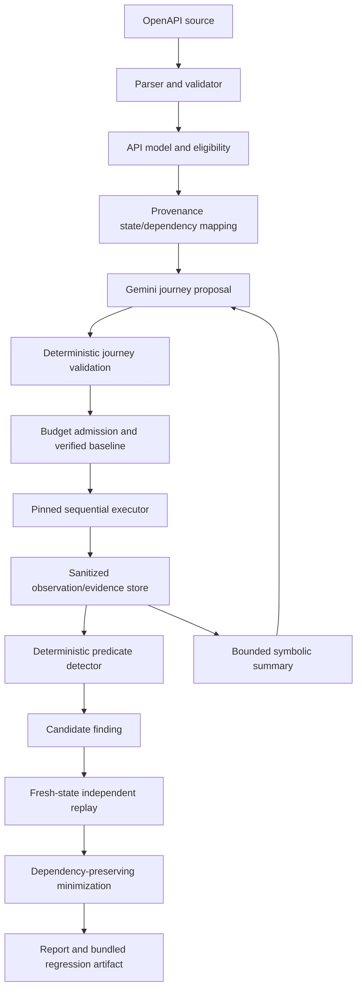

# Implementation Plan: GhostQA MVP

**Branch**: `001-ghostqa-mvp` | **Date**: 2026-09-30 | **Spec**: [spec.md](spec.md)

**Input**: `specs/001-ghostqa-mvp/spec.md`, both clarification passes, constitution,
requirements-quality review, PRODUCT.md and DESIGN.md. Latest user direction adopts an all-
TypeScript backend; PRODUCT.md's FastAPI recommendation was explicitly pending and is not binding.

## Summary

Prove blind workflow discovery before building broad product surfaces. A single locally operated,
self-hosted Next.js app controls one sequential run through a framework-independent TypeScript
engine. Gemini proposes only; deterministic modules validate, establish baseline, send bounded
requests, evaluate immutable predicates, replay, minimize, and produce reports/artifacts. PostgreSQL
stores sanitized immutable snapshots and evidence, with encrypted project secrets stored separately
from their key. No FastAPI, queue, Redis, microservice, hosted tenancy, or arbitrary scripting.

## Technical Context

**Language/Version**: TypeScript 5; Node 24 LTS; exact patch versions locked at implementation.
**Primary Dependencies**: Next.js 16, Tailwind 4, Zod 4, @scalar/openapi-parser, yaml 2, Ajv 8,
ajv-formats, @google/genai, pg; Vitest, tsx/esbuild for development/build tooling.
**Storage**: PostgreSQL 17+, SQL migrations, JSONB structured snapshots/evidence.
**Testing**: Vitest unit/contract/integration; seeded fixture benchmark; manual UI acceptance.
**Target Platform**: self-hosted local Node/macOS/Linux, browser desktop/mobile; loopback UI only.
**Project Type**: one application with importable engine library and fixture development target.
**Performance Goals**: spec SC-001/007 setup/comprehension and SC-005 two-second cancel visibility;
no load/throughput promise. Default 200 requests/10 minutes/20 journeys/10 steps.
**Constraints**: strict no-raw-secret model input; one target request in flight; all-phase budgets;
verified baseline every trial; long-lived process required, not Edge/serverless deployment.
**Scale/Scope**: one operator, one active run globally, three required benchmark pairs plus two
explicitly requested supplemental fixture pairs. No duplicate-idempotency fourth extension.

## Constitution Check

| Principle / gate | Pre-research | Post-design evidence |
| --- | --- | --- |
| Workflow/state integrity | Pass | Operation model, provenance-tagged mapping and blinded dependent journeys; no input-only substitute. |
| Deterministic/reproducible | Pass | Validated plans, sole transport/budget authority, immutable predicates, fresh replay, bundled runner. |
| Evidence before confirmation | Pass | Pure finding reducer admits CONFIRMED only from initial/replay VIOLATED evidence and eligible predicate. |
| Bounded/isolated execution | Pass | Frozen addresses/scope, operation exclusions, encrypted credentials, same budget through all phases. |
| Developer clarity/quality | Pass | Structured session view, AP-001–011 verification, keyboard/status support, fixture tests. |
| Scope and simplicity | Pass | One runtime/DB; worker isolation justified by hard deadlines; no speculative services. |

No governance exceptions. Constitution remains unchanged. Research decisions are resolved;
implementation proof gates below are explicit and do not authorize weakening requirements.

## Project Structure

### Documentation (this feature)

```text
specs/001-ghostqa-mvp/
  spec.md
  plan.md
  research.md
  data-model.md
  quickstart.md
  contracts/core-types.md
  contracts/application-api.md
  contracts/engine-lifecycle.md
  checklists/
```

### Source Code (repository root; proposed, not created)

```text
src/
  app/                       # projects, imports, runs, findings, Node route handlers
  components/                # technical session/trace/result controls
  server/                    # supervisor, repositories, encrypted credential store
  engine/
    contracts/               # Zod schemas, inferred TS contracts
    openapi/                 # library adapter, profile classification, API model
    mapping/                 # dependency/state provenance, no authority
    planning/                # provider interface, Gemini, sanitized context
    validation/              # journey/binding/input-schema/predicate validation
    policy/                  # URL, operations, frozen scope
    budget/                  # single BudgetManager
    secrets/                 # taint, vault, sanitizer
    execution/               # pinned transport, variables, step execution
    fresh-state/             # reset/baseline/trial admission
    observations/            # redacted evidence sink and summaries
    detection/               # pure predicate evaluation and finding reducer
    verification/            # independent replay
    minimization/            # deterministic single-step deletion
    exports/                 # report, manifest, fixed runner bundle
    session/                 # orchestration and termination
  cli/                       # benchmark and independent regression invocation
fixtures/api/                # Node HTTP fixture; neutral public OpenAPI
fixtures/private/            # evaluator variant map/invariants, never planner input
server.ts                    # persistent app lifecycle / engine worker supervision
tests/unit/
tests/contract/
tests/integration/
tests/benchmark/
migrations/                  # minimal numbered SQL
```

**Structure Decision**: single package, ordinary modules. No workspace split, plugin interface,
or invented shared service. Engine is importable from UI server and regression runner without Next.

## Architecture and module responsibilities



`openapi` wraps mature parsing, not hand-written parsing. `mapping` retains four distinct kinds;
agent hypotheses never become runtime facts. `validation` rejects unknown fields/operations,
undeclared parameters, forbidden body properties and unresolved dependency structure. `policy`
compiles frozen approval into a capability held only by executor. `fresh-state` owns trial setup,
not networking. `budget` supplies the sole run accounting inside the supervisor-owned dispatch path. `execution`
is the only target transport. `detection` is pure, does not call the model. `verification` and
`minimization` reuse the same trial executor and predicate. `exports` compiles fixed code and
validated data, not LLM code. Repositories receive only sanitized records except encrypted secrets.

## Runtime ownership and persistence lifecycle

Use a small persistent custom Node server launching Next and owning a RunSupervisor. It accepts
one active run, holds a dedicated PostgreSQL advisory-lock connection to prevent duplicate local
instances, and supervises one engine worker thread. Routes use an application-local bridge to
supervisor commands, not module-level route promises. Development hot reload cannot spawn a second
supervisor. Reject another start as busy; no pending queue. Worker gets only explicit configuration
and capabilities. The supervisor owns one run-scoped dispatcher in the persistent Node process:

`RunSupervisor → BudgetManager → frozen ScopePolicy / operation policy → cancellation check
→ deterministic HTTP Executor`

The existing engine worker performs orchestration and bounded computation, submitting structured
execution intents to this dispatcher. It has no target socket/HTTP dispatch capability. The
BudgetManager and target transport live in the supervisor-owned dispatcher, not copied into the
worker. All reset, baseline, exploration, replay, minimization, and artifact-verification intents
use the same dispatcher and budget instance. Phase modules cannot authorize requests or maintain
shadow counters. Structured messages carry IDs/data, not serialized execution capabilities.

Use a monotonic deadline plus parent watchdog; terminate stuck workers and mark interrupted work,
including import parsing after ten seconds. Cancellation, advisory-lock connection loss, or
supervisor shutdown synchronously closes the dispatch gate. Cancellation ACK occurs only after
that gate is closed. Abort in-flight sockets where possible; no target-side rollback is claimed.
After any awaited persistence/policy work, recheck the closed gate immediately before socket
creation; no asynchronous gap is allowed between that final check and dispatch. Lost advisory
ownership stops the current run; it is never reacquired to silently resume dispatch.
Transactions persist run acceptance and sanitized event outcomes. Before each dispatch persist the
consumed budget/in-flight intent; database failure stops before sending. On crash an intent may
not have been sent, but conservative accounting never refunds it or automatically repeats it.
Worker progress is persisted before being presented. On startup mark prior nonterminal runs
INTERRUPTED; never resume/reset or repeat mutations. UI polls at 500 ms only while active, then stops.
Database failures fail closed. One worker is not a sandbox for arbitrary code: no arbitrary code
is ever accepted. Later hosted execution can move this same engine to an owned worker process;
that is a future deployment change, not infrastructure built now.

## Engine lifecycles

See [engine-lifecycle.md](contracts/engine-lifecycle.md) for exact loop, predicates, baseline,
verification, minimization, transport, budgets and secrets. See [core-types.md](contracts/core-types.md)
for TypeScript designs and [data-model.md](data-model.md) for persistence boundaries.
The central rule is `trial = admit(reset + checks + journey) → reset → verify baseline → execute
journey → evaluate immutable predicate`; every phase, including interpretation of the exact exported manifest,
uses it. Variable values are fresh each trial; declarations and dependency relations are stable.

## Fixture architecture and benchmark

Implement a separate local Node HTTP development fixture in the same repository, in-memory state,
neutral JSON OpenAPI, POST reset and GET baseline inspection. Launch one scenario/variant at a time
on an explicit origin/base path to prevent the first-found stop from masking later scenarios.
Required accepted benchmark: email-or-password-change/reset token; cancellation/fulfillment; membership-revoke/
old token. Latest request adds revoked-invitation acceptance and deleted-resource stale modification
as small supplementary pairs. They do not replace SC-002's three required pairs and do not raise its
aggregate threshold. No idempotency expansion. All five share reset, finite state and error envelope.
Faulty/fixed variants differ only in the guarded state check, with identical public contracts.

Tokens are returned as sensitive JSON fields by fixture-only HTTP actions; no email interception,
browser login, cookies, or external origins. Evaluator-private scenario labels/variant switches are
never included in planner context. Approved invariants describe expected final behavior but not
triggering sequences. Reset/check operations are control operations excluded from model exploration,
yet approved for fresh-state phases. Each benchmark trial starts with empty planner history and
same frozen engine/model/configuration. Persist all five trials per required variant, including
failures, request phase counts, model calls, token estimates, original/minimized lengths. Separate
redundant-journey minimization tests from blind discovery. Paired artifact runs are independently
bounded and approved. No tuning GhostQA midway through a recorded benchmark.

## UI and visual reference

Session execution is the center: phase/status and budget header; ordered journey trace; current
predicate and evidence; structured agent rationale/provenance; findings rail. Not a chat interface.
Projects → import/endpoint eligibility → configuration/reset/assertions/scope approval → session →
finding detail/minimal reproduction/export. Dense readable tables and monospace trace values;
expand details rather than requiring full raw payloads. DESIGN.md's charcoal surfaces, functional
accent and compact hierarchy are inspiration; no Spotify branding/assets/proprietary fonts or
music-player controls. Use system sans/mono initially, restrained semantic status colors plus text.
Tailwind styles after core slice works. Respect PRODUCT.md and 375px/keyboard acceptance without
visual-test infrastructure. Design refinement is deferred until demonstrated engine behavior.

## Testing and implementation phases (dependency order)

1. **Contracts and fixture proof**: Zod types, predicate semantics, reset/baseline schema, password
   fixture faulty/fixed pair and minimal repository migrations. Test exact reset/invariant outcome.
2. **Safety and execution foundation**: encrypted secrets/sanitizer, frozen scope, budget manager,
   Node transport and variable flow; prove socket IP/SNI/cert checks, no redirects, cancellation,
   encoding/header rejection and limits before connecting real targets.
3. **OpenAPI adapter**: parser library/no-loader compatibility matrix, schema validator, eligibility,
   snapshots and mapping. No free-form parser replacement if compatibility gate fails.
4. **First complete vertical slice**: live Gemini proposal → validation → fresh trial → observations
   → deterministic suspicion → approved-predicate replay → confirmation → greedy minimization →
   Markdown/JSON report → exact-manifest verification through the existing engine. Include persistence/restart. Do not
   call seeded reproduction a discovery. Gate: live blind password fixture can complete full proof.
5. **Robustness/benchmark**: all required pairs plus requested supplemental pairs; mocked model,
   failure classifications, adversarial content, constraints, redaction and AP-002–005/008–011.
   Freeze code/dependencies/prompt/model before five-trial measurements; report failure honestly.
6. **Minimal product surfaces**: projects/import/explorer/configuration/session/finding/export; no
   broad dashboard, onboarding program, or aesthetic polish before slice. AP-001/006/007 acceptance.
7. **Completion**: run all AP-001–011 and SC-001–013; record artifact hashes and measured outcomes.
   Write tasks in the next workflow, not here.

Unit tests cover parser/profile mapping, operation/body resolution, Zod boundaries, variable sources,
interpolation, predicate/baseline evaluator, BudgetManager, URL policy, sanitizer, transport wrappers,
finding reducer and minimizer. Mocked providers cover valid/malformed output, hallucinated paths or
parameters, prompt injection descriptions/responses, timeout/429/refusal, immediate invalid-plan
stop versus three valid stagnant rounds. Integration tests exercise real fixture sockets, full
fresh-state lifecycle, confirmed/non-reproduced/inconclusive cases, minimizing/replaying fresh IDs,
exact-manifest supervised verification, independent bundle execution, cancellation, shared
budget accounting, advisory-lock loss, shutdown, DB failure and restart. TLS tests use a
locally trusted test CA, never disabling certificate validation. Benchmark uses actual Gemini;
mocked-model success does not satisfy discovery criteria. UI verification is manual functional/
keyboard/mobile acceptance; no browser automation product or visual-testing system is introduced.

## Architecture readiness review — dispatch ownership

Resolved: exactly one supervisor-owned BudgetManager and HTTP dispatcher per run. The existing
engine interprets the immutable exported manifest; no artifact worker or runner dispatches during
that run. All-phase cancellation, lock loss, and shutdown close the same gate. Independent runner
invocations have separate explicit authority/budgets and cannot update original run evidence.
VERIFIED is granted only by recorded supervised-path manifest verification. No ownership blocker
remains; task generation may proceed. Implementation must prove these invariants through tests.

## Technical risks and measurable gates

- Free Gemini tier may throttle or fail 30-second deadlines; live discovery target 4/5 is unproven.
  Record failure, not silent retries or model switching. Configurable paid quota is optional later.
- Local/staging targets may not expose reset/token observation: reject unsupported setup, do not
  invent cleanup or confirm from contaminated state.
- Parser version semantics and no-loader behavior require release-specific compatibility tests.
- Native socket address/SNI certificate matching and cancellation race are early transport gates.
- Raw secrets in unmarked fields are not universally detectable; taint/default selectors bound the
  guarantee. JS cannot promise perfect memory erasure; drop references and never persist them.
- Cancellation cannot undo delivered mutations or guarantee cancellation of provider computation.
- Self-hosted persistent process is required. Exposing this unauthenticated local MVP publicly is
  unsupported; hosted SaaS later needs auth, tenancy, egress isolation and job ownership.

## Complexity Tracking

No constitutional violations requiring exceptions. One worker thread is justified by hard parse/
run deadlines and responsive cancellation; a plain event-loop timeout cannot preempt synchronous
parsing. No queued work, process fleet, Redis, or distributed lock service is added.

### Accepted schema-semantics implementation correction (2026-09-30)

Request/response validation uses preserved Schema Objects and bounded internal-reference closures
with Ajv. Scalar's flattened/dereferenced output is not authoritative where it changes combined
semantics. OpenAPI 3.1 `$ref` siblings retain JSON Schema 2020-12 semantics. OpenAPI 3.0 nullable and
reference behavior are explicitly normalized for the draft-07-compatible validator. References
remain internal; no asynchronous/remote schema loader is configured. Recursive generation and
unsupported/ambiguous constructs retain the accepted exclusions. Structural OpenAPI validation
still uses Scalar. This correction changes neither stack nor execution authority.

T017–T019 release-specific tests pass, including the permanent stricter-reference/sibling
regression. Schema snapshots preserve structural field names while redacting annotations;
semantic secret literals are explicitly excluded. Run acceptance rejects zero eligible exploration
operations. T020 is the next dependency-ready task; remaining Gate 1 tasks are not complete.
